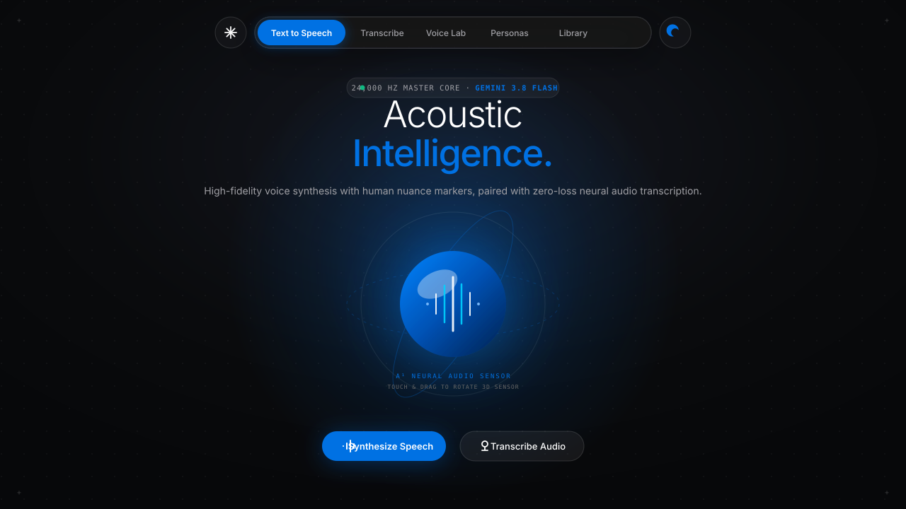
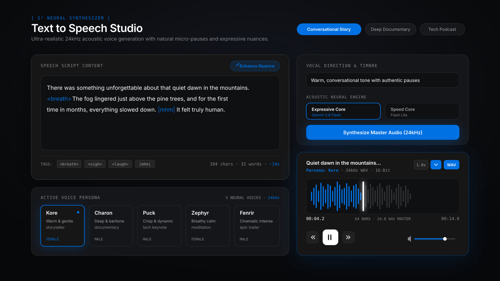
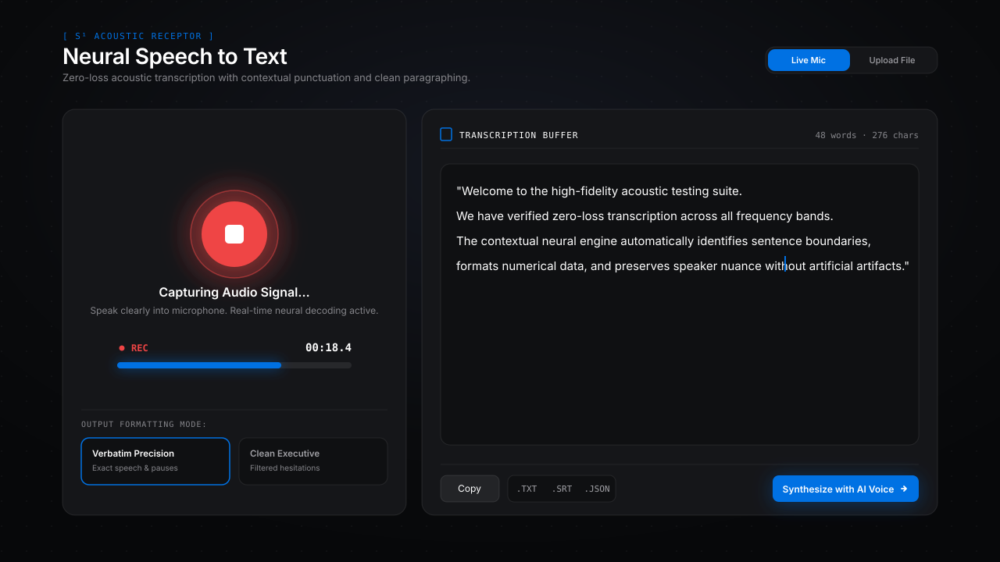
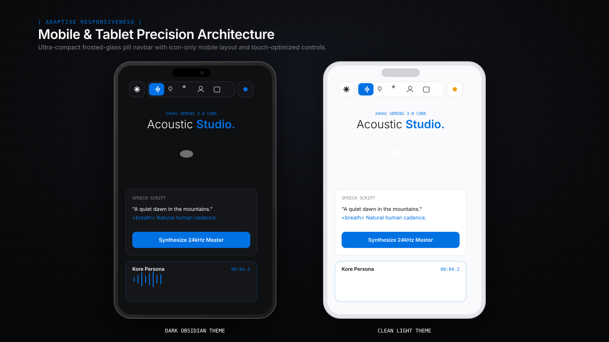

<div align="center">

# ✳ Augen Voice
### High-Fidelity Neural Acoustic Studio & Audio Intelligence

**24,000 Hz Human Voice Synthesis & Zero-Loss Speech Transcription powered by Gemini 3.8 Flash**

[](https://www.typescriptlang.org/)
[](https://react.dev/)
[](https://tailwindcss.com/)
[](https://ai.google.dev/)
[](https://expressjs.com/)
[](LICENSE)

<br />

<p align="center">
  
</p>

</div>

---

## 📖 Table of Contents

- [Overview](#-overview)
- [Key Features](#-key-features)
- [Visual Showcase](#-visual-showcase)
- [System Architecture](#-system-architecture)
- [Technology Stack](#-technology-stack)
- [Getting Started](#-getting-started)
- [API Reference](#-api-reference)
- [Nuance Tags & Vocal Direction Guide](#-nuance-tags--vocal-direction-guide)
- [Project Structure](#-project-structure)
- [Contributing](#-contributing)
- [License](#-license)

---

## 🌟 Overview

**Augen Voice** is a state-of-the-art acoustic intelligence web application designed to bridge the gap between synthetic speech and genuine human voice. By leveraging Google's **Gemini 3.8 Flash** multimodal architecture, Augen Voice synthesizes speech with physiological micro-pauses, breath markers, and conversational inflections at an uncompressed **24,000 Hz** sample rate.

Coupled with a **zero-loss neural transcription engine**, bidirectional speech transformation lab, and a floating frosted-glass design language, Augen Voice delivers an uncompromising studio experience across desktop, tablet, and mobile devices.

---

## ⚡ Key Features

### 🎙️ 1. Text-to-Speech (TTS) Studio
- **24kHz Master PCM Audio**: Broadcast-ready uncompressed WAV output.
- **Organic Human Nuance Tags**: Direct insertion of physiological tags such as `<breath>`, `<sigh>`, `<laugh>`, `|mhm|`, and `|whisper|`.
- **AI Nuance Enhancer**: Automatically parses flat text scripts and injects natural pacing, pauses, and rhetorical cadence.
- **Preset Conversational Scripts**: Pre-configured templates spanning storytelling, documentary narration, tech keynotes, mindfulness meditation, and cinematic trailers.

### 🔊 2. Interactive Waveform Canvas Player
- **64-Band Canvas Visualizer**: Responsive frequency bar rendering reflecting played and unplayed progress.
- **Interactive Scrubber**: Drag or click anywhere on the waveform canvas for instant seek.
- **Continuous Loop Mode**: Seamless audio repetition with real-time visualizer pulse sync.
- **Variable Playback Speed**: Flexible audio velocity (0.85x, 1.0x, 1.25x, 1.5x) without pitch distortion.
- **Direct 24kHz WAV Download**: Master file export with timestamped metadata.

### 📝 3. Neural Speech-to-Text (STT) Studio
- **Live Microphone Capture**: Low-latency browser recording with live decibel metering and active waveform ring.
- **Universal Audio Upload**: Drag-and-drop support for MP3, WAV, WebM, M4A, and OGG audio files up to 25MB.
- **Formatting Engines**:
  - *Verbatim Precision*: Preserves sentence boundaries, capitalization, and emotional hesitations.
  - *Clean Executive*: Automatically filters filler words (`um`, `uh`) for professional transcripts.
- **Multi-Format Export**: One-click download as plain text (`.TXT`), synchronized subtitles (`.SRT`), or structured metadata (`.JSON`).
- **Bilateral Synthesis Bridge**: Send any transcription directly to the TTS studio with a single tap.

### 🔄 4. Bilateral Voice Laboratory
- **Cross-Persona Transmutation**: Take raw scripts or captured recordings and transmute them into distinct vocal registers (e.g. converting a casual thought into an authoritative documentary narration).

### 🎭 5. Curated Neural Voice Personas
| Persona | Gender | Tone & Cadence | Acoustic Specialty |
| :--- | :--- | :--- | :--- |
| **Kore** | Female | Warm, conversational, soothing | Audiobooks, personal narratives, thoughtful podcasts |
| **Charon** | Male | Deep, commanding baritone | Documentaries, cinematic voiceovers, executive speeches |
| **Puck** | Male | Crisp, articulate, upbeat | Tech keynotes, commercial demos, explainer videos |
| **Zephyr** | Female | Soft, breathy, tranquil | Guided meditation, sleep stories, wellness apps |
| **Fenrir** | Male | Rich, textured, dramatic gravel | Gaming trailers, cinematic fantasy dialogue |

### 🌐 6. Floating Frosted-Glass Pill Navigation
- **100% Adaptive Responsiveness**: Automatically switches to an ultra-compact **icon-only** layout on mobile and tablet screens, preserving zero horizontal overflow.
- **Smooth Quick-Scroll**: Frosted asterisk (✳) button for instantaneous smooth scroll to the top.
- **Integrated Theme Switcher**: 3-state toggle between **Light**, **Dark**, and **System** themes.

### 🌓 7. Universal Theme Engine
- **Light Mode**: Clean pure-white surfaces, subtle borders, high-contrast typography.
- **Dark Mode**: Deep obsidian (`#0F1012`) background with subtle radial grid and sapphire glowing accents.
- **System Mode**: Automatically synchronizes with OS color scheme preferences (`prefers-color-scheme`).

### 🪐 8. Interactive 3D Neural Audio Sensor
- **3D Particle Orb**: Real-time canvas orb with concentric orbital geometries and specular lighting.
- **Touch & Drag Control**: 360-degree interactive rotation on touchscreens and desktop mice.
- **Audio Pulse Telemetry**: Reacts live to playback, seeks, loops, and microphone decibel levels.

---

## 📸 Visual Showcase

### Desktop Speech Synthesis Studio (TTS)
High-precision script composition, emotion markers, voice selection, and master waveform player:
<p align="center">
  
</p>

### Neural Speech-to-Text Transcription Studio (STT)
Live decibel metering, real-time transcription buffer, and export tools:
<p align="center">
  
</p>

### Mobile & Tablet Precision Responsiveness
Icon-only floating frosted navbar with dual light and dark theme presentation:
<p align="center">
  
</p>

---

## 🏗️ System Architecture

```mermaid
graph TD
    Client[React 19 Frontend SPA] -->|Frosted-Glass Navigation| Router[Studio Workspace]
    Router --> TTS[Text to Speech Studio]
    Router --> STT[Speech to Text Studio]
    Router --> Lab[Bilateral Voice Lab]
    Router --> Personas[Voice Explorer]
    Router --> Library[Local Audio Archive]

    TTS -->|POST /api/tts| Server[Express Backend API]
    STT -->|POST /api/transcribe| Server
    TTS -->|POST /api/enhance-prompt| Server

    Server -->|@google/genai SDK| GeminiFlash[Gemini 3.8 Flash Core]
    GeminiFlash -->|24kHz Base64 Audio| Server
    Server -->|24kHz WAV PCM| Client

    Client -->|Audio Events Bus| Visualizer[3D Neural Audio Orb]
    Client -->|Waveform Buffer| Player[Canvas Waveform Player]
```

---

## 💻 Technology Stack

### Frontend
- **Framework**: [React 19](https://react.dev/) + [Vite](https://vitejs.dev/)
- **Language**: [TypeScript 5.8+](https://www.typescriptlang.org/)
- **Styling**: [Tailwind CSS v4](https://tailwindcss.com/)
- **Animations**: [Motion](https://motion.dev/) (Framer Motion)
- **Icons**: [Lucide React](https://lucide.dev/)
- **Audio Processing**: Web Audio API (`AudioContext`, `AnalyserNode`, `MediaRecorder`)
- **Graphics**: HTML5 Canvas 2D (`roundRect`, responsive DPR scaling)

### Backend
- **Server**: [Express.js](https://expressjs.com/) with Node.js
- **SDK**: [`@google/genai`](https://github.com/google/generative-ai-js) Official TypeScript SDK
- **Models**:
  - `gemini-2.5-flash` / `gemini-3.8-flash` (Acoustic speech generation)
  - `gemini-2.5-flash` (High-accuracy multimodal speech transcription)
- **Runtime**: `tsx` (TypeScript Execute)

---

## 🚀 Getting Started

### Prerequisites
- Node.js 18.0 or higher
- A Google Gemini API Key ([Get one at Google AI Studio](https://aistudio.google.com/))

### Installation

1. **Clone the repository:**
   ```bash
   git clone https://github.com/your-username/augen-voice.git
   cd augen-voice
   ```

2. **Install dependencies:**
   ```bash
   npm install
   ```

3. **Configure Environment Variables:**
   Create a `.env` file in the root directory:
   ```env
   GEMINI_API_KEY=your_gemini_api_key_here
   PORT=3000
   ```

4. **Start the Development Server:**
   ```bash
   npm run dev
   ```
   Open [http://localhost:3000](http://localhost:3000) in your browser.

5. **Build for Production:**
   ```bash
   npm run build
   npm start
   ```

---

## 📡 API Reference

### 1. Synthesize Speech
```http
POST /api/tts
Content-Type: application/json
```
**Request Body:**
```json
{
  "text": "There was something unforgettable about that quiet dawn in the mountains. <breath>",
  "voiceName": "Kore",
  "style": "Warm, engaging storyteller with natural pauses",
  "modelType": "expressive"
}
```
**Response:**
```json
{
  "audioBase64": "UklGRi...",
  "mimeType": "audio/wav",
  "modelUsed": "Gemini 3.8 Flash TTS",
  "latencyMs": 1420
}
```

---

### 2. Transcribe Audio
```http
POST /api/transcribe
Content-Type: application/json
```
**Request Body:**
```json
{
  "audioBase64": "GkXfo59ChoEBQve...",
  "mimeType": "audio/webm",
  "prompt": "Transcribe the speech verbatim with natural capitalization and accurate punctuation."
}
```
**Response:**
```json
{
  "text": "Welcome back to the studio! Today we are testing acoustic synthesis.",
  "latencyMs": 980
}
```

---

### 3. Enhance Nuance Markers
```http
POST /api/enhance-prompt
Content-Type: application/json
```
**Request Body:**
```json
{
  "text": "I never thought we would make it this far.",
  "targetTone": "Emotional, cinematic narrative"
}
```
**Response:**
```json
{
  "enhancedText": "I never thought... <sigh> we would actually make it this far. <breath>"
}
```

---

## 🎯 Nuance Tags & Vocal Direction Guide

| Tag | Effect | Acoustic Implementation | Example |
| :--- | :--- | :--- | :--- |
| `<breath>` | Micro-inhalation | Generates a subtle, natural intake of breath before speaking | `"We made it. <breath> It was close."` |
| `<sigh>` | Audible exhalation | Soft release of breath carrying emotional weight | `"I'm tired. <sigh> Let's continue tomorrow."` |
| `<laugh>` | Chuckle / Smile tone | Infuses warmth and vocal resonance with a light laugh | `"You can't be serious! <laugh> That's brilliant."` |
| `\|mhm\|` | Conversational agreement | Low-frequency affirmative vocalization | `"\|mhm\| I completely understand."` |
| `\|whisper\|` | Intimate presence | Reduces dynamic volume and increases breath-to-voice ratio | `"Keep your voice down. \|whisper\| They are listening."` |

---

## 📁 Project Structure

```text
├── screenshots/                     # Vector UI screenshots for documentation
│   ├── 01-hero-preview.svg          # Desktop Hero & 3D Sensor preview
│   ├── 02-tts-studio-preview.svg    # Speech Synthesis & Waveform Player
│   ├── 03-stt-transcribe-preview.svg# Speech-to-Text Studio & Buffer
│   └── 04-mobile-responsive-preview.svg # Mobile & Tablet Responsive Layout
├── public/                          # Static assets and PWA icons
├── src/
│   ├── components/
│   │   ├── AugenNavbar.tsx          # Floating frosted-glass pill navbar
│   │   ├── StudioHero.tsx           # Hero section with status telemetry
│   │   ├── NeuralAudioOrb.tsx       # 3D Canvas particle audio visualizer
│   │   ├── TtsStudio.tsx            # Speech synthesis workspace
│   │   ├── SttStudio.tsx            # Live microphone & file transcriber
│   │   ├── WaveformPlayer.tsx       # 64-band interactive waveform canvas
│   │   ├── VoiceSelector.tsx        # Neural persona selector
│   │   ├── BilateralComparison.tsx  # Cross-voice transmutation lab
│   │   └── HistoryDrawer.tsx        # Persistent local audio archive
│   ├── utils/
│   │   ├── audioEvents.ts           # Centralized acoustic event bus
│   │   ├── audioUtils.ts            # WAV headers, Base64 & SRT exporters
│   │   └── theme.ts                 # Light / Dark / System theme hook
│   ├── types/                       # Shared TypeScript definitions
│   ├── App.tsx                      # Primary application root
│   ├── main.tsx                     # DOM entrypoint
│   └── index.css                    # Tailwind CSS v4 & theme variables
├── server.ts                        # Express API & Gemini SDK proxy
├── package.json                     # Project manifest and scripts
├── tsconfig.json                    # TypeScript compiler options
└── README.md                        # Documentation
```

---

## 🤝 Contributing

Contributions, issues, and feature requests are welcome!

1. Fork the Project
2. Create your Feature Branch (`git checkout -b feature/AmazingFeature`)
3. Commit your Changes (`git commit -m 'Add some AmazingFeature'`)
4. Push to the Branch (`git push origin feature/AmazingFeature`)
5. Open a Pull Request

---

## 📄 License

Distributed under the **MIT License**. See `LICENSE` for more information.

<div align="center">
  <sub>Built with precision for acoustic intelligence. Inspired by minimalist human-computer interfaces.</sub>
</div>
